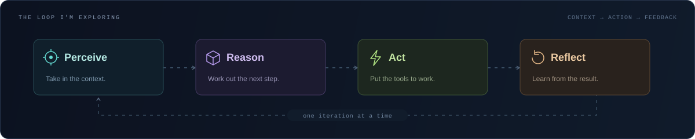

  

<h1 align="center">Hey, I'm Zihang. 👋</h1>

  Building intelligent agent applications with <strong>Go</strong>. 
  Exploring the architectures that turn ideas into useful systems.

  
  &nbsp;
  
  &nbsp;
  

 

### `01` / Behind the terminal

<!-- Illustration: https://github.com/AVS1508/AVS1508/blob/master/assets/Night-Coding.gif -->

I'm **Zihang Xu**, a developer interested in the space where backend engineering meets intelligent agents.

- **On the workbench** → an intelligent agent application in Go.
- **Down the rabbit hole** → advanced AI agent architectures.
- **Happy to talk about** → Go, Python, backend development, AI agents, and system design.
- **Best coding hours** → after midnight. The code just comes out cleaner.

 
 

### `02` / The rabbit hole

I'm exploring how agents take in context, decide what to do, use tools, and learn from the result.

  <picture>
    <source media="(max-width: 640px)" srcset="./assets/agent-loop-compact.svg" />
    
  </picture>

 

---

<h3 align="center">Interesting problem? Let's build something.</h3>

  AI agents, backend systems, or an idea worth staying up for. 
  <a href="mailto:argocot@gmail.com"><strong>argocot@gmail.com ↗</strong></a>

  <samp>think → build → learn → repeat</samp>  
  Made of curiosity. Usually compiled after midnight. 🌙

